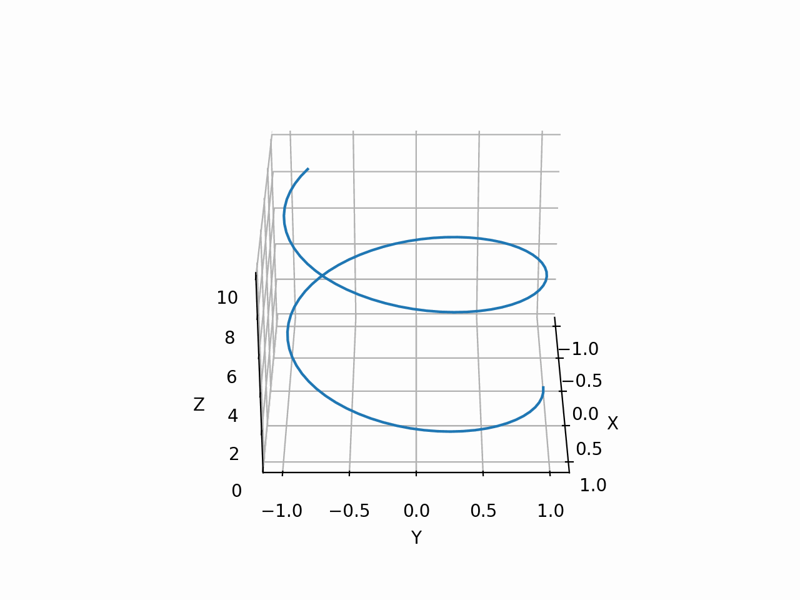
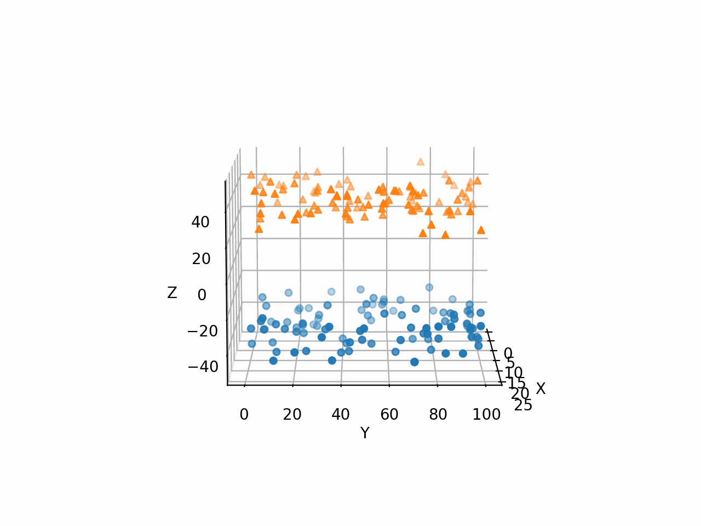
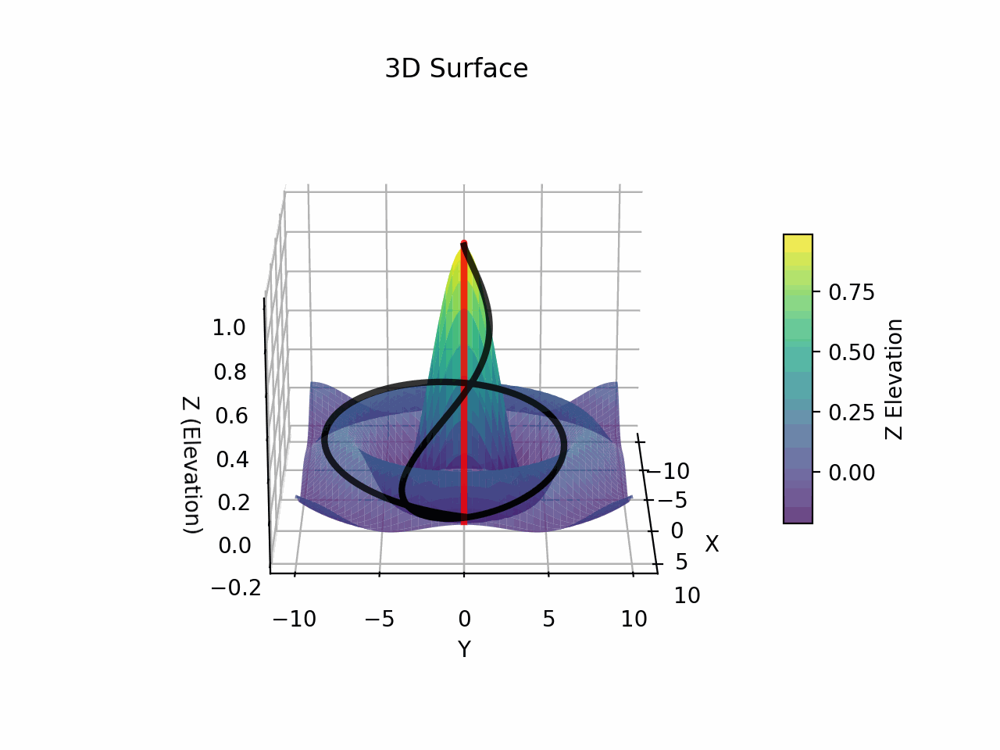
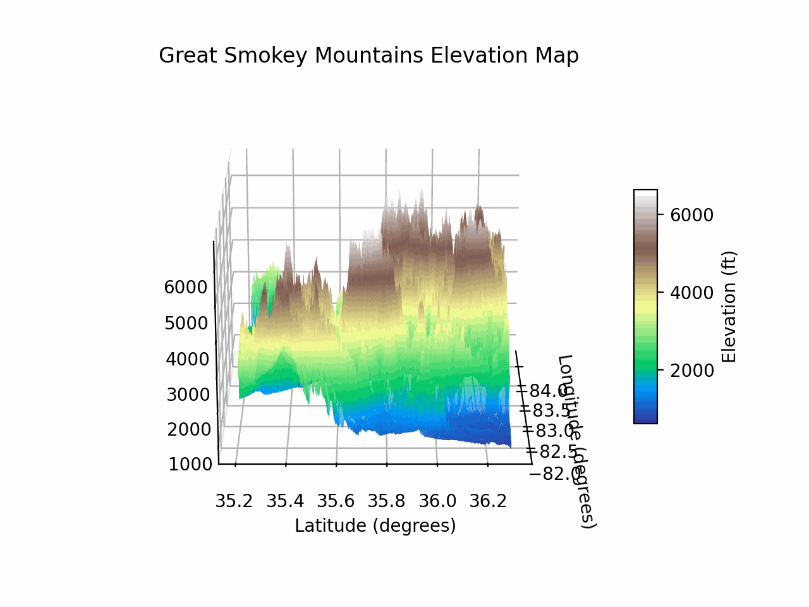

# Table of Contents
- [Notes To Learn 3D Visualization](#Notes)
- [Basic Parametric and Scatter Plots](#parametric-and-scatter-plots)
- [Surface Notes and Creation](#going-from-parametric-and-scatter-to-surface)
- [Practice With Real World Data](#Real-World-Data)
- [Smokey Mountains Elevation Visualization](#smokeys-elevation-visualization)

# NOTES
## Linspace vs. Arange
<i>Why use linspace instead of arange?</i>
    Arange never includes stop value and needs a step range, linspace provides more accurate, predictable, and reliable data.
    Linspace also is easier to find steps between say irrational numbers such as pi

### Parametric and Scatter Plots

## Going from parametric and scatter to Surface
Parametric and scatter plots take data in that is in a form of a 1D array.
For these, they use x, y, z as a single path through space.

When working towards a surface, we need to have data in a form of a 2D array.
Consider a surface as a "carpet" or "sheet", every x-value must meet every y-value.
Then, these are evaluated at the z-axis to create the carpet
    
<b>Introduce: np.meshgrid...</b>
<i>ooooo.... ahhhhhh....</i> lol

<i>What is a meshgrid and how does it work?</i>
    
    A meshgrid takes in two numpy arrays and creates a grid between the two. 
    Say inputs x and y. These inputs will create two grids, say X and Y. X would have the values of x repeated for len(y) rows and vice versa.
    
    What we can do with X and Y is create Z: Z controls the shape of the carpet

<b>Possible Shapes</b>
    
    Paraboloid (Bowl) - Z = X**2 + Y**2
    Saddle Surface - Z = X**2 - Y**2
    etc...
    Z doesn't have to be a formula...
    Z can just be a 2D array of real-world measurements! (This is what I'll eventually be doing)

### Surface Plot

## Adding a line ON the surface
All I have to do is add an additional plot onto the ax. The plot will be a line with valid data. Think of the surface as a 'carpet' and the line is 'footprints'
The meshgrid created 2D matricies of shape 100x100, the line needs x,y,z 1D arrays of size N. N can be any number I choose, ie. 200 'steps'.
    
    Hypothesising for later: N would be the amount of times the gradient is changed until convergence.
    Study says N=100-300 is the 'sweet spot' for 3D

### Surface Plot with Lines

# Real-World-Data
## Visualize Great Smokey Mountains
I love hiking. This last summer I did a five-day backpacking trip to The Great Smokey Mountains national park. My brother, my friend, and I sent out on this expedition in the North-Eastern part of the park. There were moments were we were on the Appalachian Trail and the border of Tennessee and North Carolina. We did a total of around 40 miles and it was definitely a memory I'll cherish forever.

 Me on the left - All photos were on my film camera, there's more in that folder if interested

### Smokeys Elevation Visualization

The graph animation is short due to run time and I was impatient...

