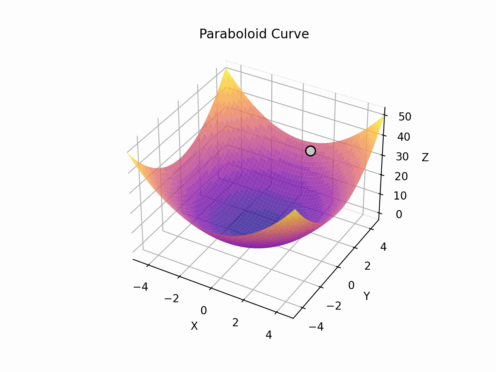

# Table Of Contents
- [Gradient Descent](#gradient-descent)
- [Visualizing Descent](#visualizing-descent)
    - [On a Paraboloid](#visualizing-on-a-paraboloid)
        - [Gif of Visualization](#paraboloid-gif)
    - [Real World Data](#visualizing-on-real-world-data)

# Notes
## Gradient Descent
An alogrithm that moves along "the path of steepest descent" thats why we subtract it from our current point to 'walk down' that slope bit by bit based on a learning rate.
In general, it is trying to find a basin, ie. when slope is 0. 
Gradient Descent can perform until convergence or when a threshold is met. 

In the real world, we typically perform gradient descent on a <b>loss function</b>. Loss functions model prediction error. During descent, we try to update parameters to minimize the loss, that is why we descent.

We create this parameter update rule
$$\theta_{t+1} = \theta_t - \eta \nabla L(\theta_t)$$

## Visualizing Descent 
### Visualizing on a Paraboloid
To just lubricate the gears, I'm going to do gradient descent on a paraboloid. 
Doing this helped me see the setup for the visualization and dip my toes into gradient descent.
#### Paraboloid Gif
 

### Visualizing on Real World Data
To visualize gradient descent, the best option is to do it based on a prediction using linear regression with a single feature as we can use w (weight) and b (bias) as our X and Y, and our loss function as Z